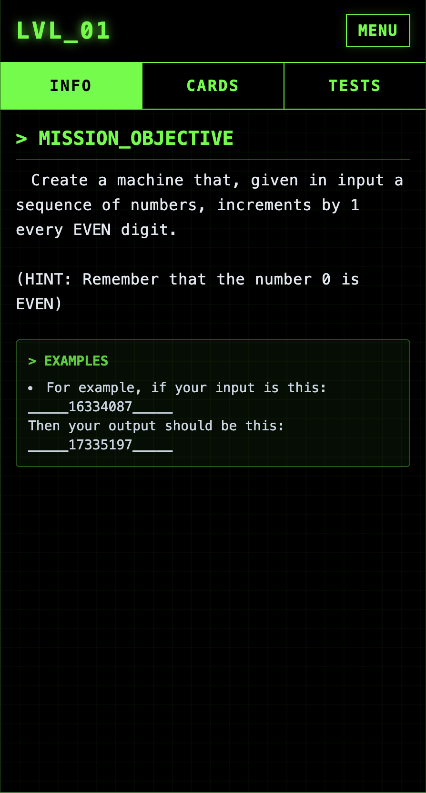
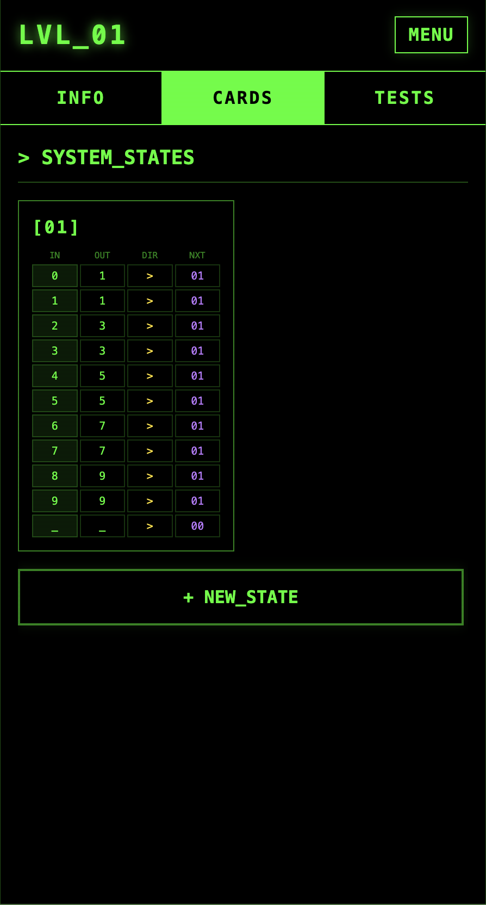
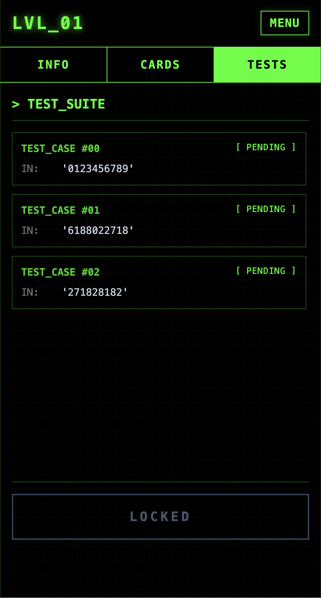
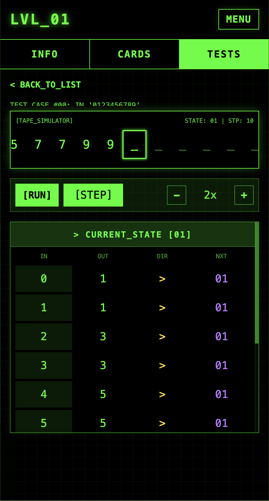

# 📖 HƯỚNG DẪN CHƠI TURING MACHINE

<p align="center">
  
  
  
  
</p>

## 🎯 Mục tiêu

Lập trình một cỗ máy để biến đổi chuỗi **Input** thành **Expected Output** bằng cách đọc, ghi và di chuyển trên băng dữ liệu.

## 🧩 1. Các thành phần chính

- **Tape:** Dải ô chứa các ký tự như `0`, `1`, `_`, ...
- **Head:** Đầu đọc, dùng để đọc và thay đổi ký tự trên Tape.
- **State Card:** Thẻ chứa các quy tắc điều khiển máy.
  - `01`: Thẻ bắt đầu.
  - `00`: Thẻ kết thúc (dừng máy).
  - `02`, `03`, ...: Các thẻ xử lý bổ sung.

## ⚙️ 2. Cách lập trình

Trong tab **CARDS**, mỗi quy tắc gồm 4 phần:

| Cột | Chức năng |
| --- | --- |
| **IN** | Ký tự máy đang đọc |
| **OUT** | Ký tự muốn ghi vào ô |
| **DIR** | Di chuyển: `>` phải, `<` trái, `-` đứng yên |
| **NEXT** | Thẻ sẽ chuyển đến tiếp theo |

**Ví dụ:** `IN: 0 → OUT: 1 → DIR: > → NEXT: 01`

Nghĩa là: Khi gặp `0`, máy đổi thành `1`, di chuyển sang phải và tiếp tục thực hiện thẻ `01`.

> 💡 Muốn dừng máy, hãy đặt `NEXT = 00`.

## 🎮 3. Các bước chơi

1. **INFO:** Đọc yêu cầu và xem kết quả cần đạt.
2. **CARDS:** Thiết lập quy tắc trong thẻ `01`. Thêm thẻ nếu cần.
3. **TESTS:** Chạy thử chương trình:
   - **Step:** Chạy từng bước.
   - **Play/Pause:** Chạy tự động hoặc tạm dừng.
   - **Reset:** Chạy lại từ đầu.
4. **SUBMIT:** Khi tất cả bài kiểm tra đều **Passed**, nhấn **SUBMIT** để hoàn thành màn chơi.

## 💡 Mẹo nhỏ

Hãy nghĩ đơn giản: **Đọc gì → Ghi gì → Đi đâu → Làm gì tiếp?**

Chỉ cần lặp lại 4 câu hỏi này để xây dựng chương trình của bạn!

## 🌐 Ngôn ngữ đề bài

Mở Console trong công cụ dành cho nhà phát triển của trình duyệt để đổi ngôn ngữ:

```js
turingLanguage('vi') // Mô tả đề bài và ví dụ bằng tiếng Việt
turingLanguage('en') // Mô tả đề bài và ví dụ bằng tiếng Anh
turingLanguage()     // Xem ngôn ngữ đang dùng: 'en' hoặc 'vi'
```

Mặc định là tiếng Anh. Lựa chọn được lưu trên trình duyệt và áp dụng cho cả 25 màn chơi. Chỉ nội dung bên trong **MISSION_OBJECTIVE** và **EXAMPLES** được chuyển ngữ; tên màn chơi, nhãn và các nút giao diện vẫn giữ tiếng Anh.

## 🛠️ Chế độ admin

Chạy trong Console của trình duyệt:

```js
turingAdmin()      // Bật admin, mở toàn bộ màn chơi
turingAdmin(false) // Tắt admin, mở khóa màn theo tiến độ đã hoàn thành
```

Trạng thái bật/tắt được lưu trên trình duyệt. Tắt admin vẫn giữ nguyên lời giải và tiến độ đã hoàn thành.
